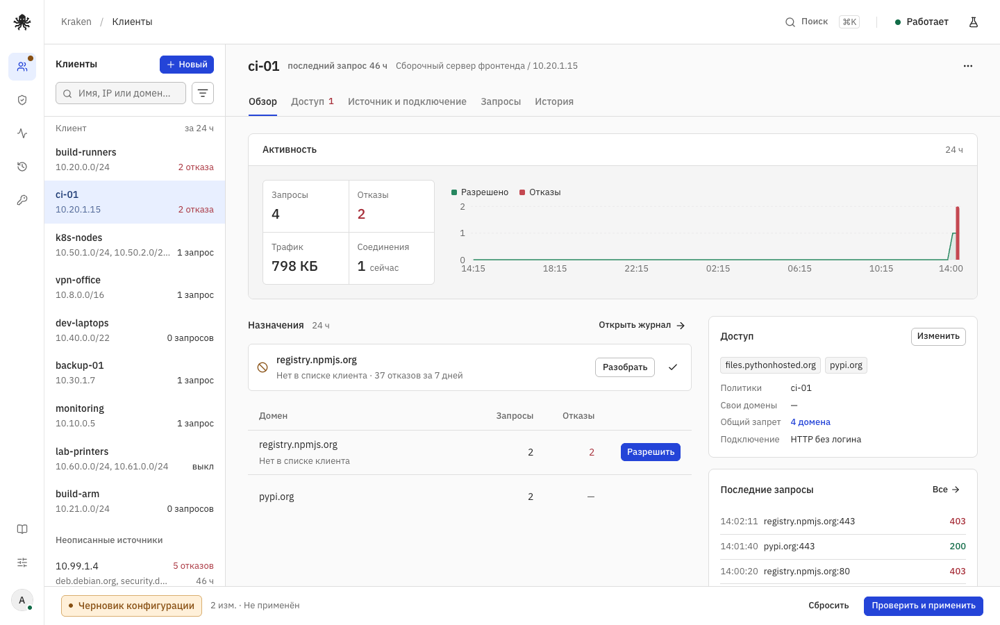

# Kraken

Web-панель для управления исходящим доступом клиентов через Squid. Клиент — устройство,
адрес, сеть или группа; каждому открывается весь веб, только разрешённые домены или
ничего. Журнал показывает, кто куда ходил, почему получил отказ и что поправить.



- **Доступ закрыт по умолчанию.** Внутренние адреса, metadata, manager Squid и опасные
  порты запрещены всегда, даже в режиме «весь веб».
- **Черновик отдельно от трафика.** Правки копятся в черновике; применение — отдельная
  операция с проверкой squid.conf, журналом и автоматическим откатом.
- **Диагностика отказов.** Журнал запросов и доменов за период до 30 дней, причина
  каждого отказа и действие «разрешить» прямо из журнала.
- **Роли.** Администратор и менеджер с областью назначенных клиентов и сетей; логины
  прокси через TLS.
- **HTTPS без расшифровки.** Сайты идут сквозным CONNECT с исходным сертификатом.

Один контейнер: Alpine, Squid из upstream-релиза, Pebble и Go-бинарник со встроенным
React UI. Без Docker socket, privileged mode и shell API. Личный проект; что
реализовано и проверено — в [статусе](docs/status.md).

## Быстрый старт

Нужны Docker Engine с Compose и свободные `localhost:8443` и `localhost:3128`.

```sh
make image
docker compose -f deploy/compose.yaml up -d
docker exec -it kraken kraken dev-cert                        # самоподписанный сертификат
docker exec -it kraken kraken bootstrap --username admin      # первый администратор
```

Вместо `make image` можно взять опубликованный образ (amd64 и arm64):
`KRAKEN_IMAGE=ghcr.io/grshv/kraken:main docker compose -f deploy/compose.yaml up -d --no-build`.

Панель — [https://localhost:8443](https://localhost:8443), прокси — `localhost:3128`.
Пароль вводится без эха и передаётся через stdin; пароля по умолчанию нет, в БД хранится
только Argon2id. Порты публикуются на loopback; для клиентов из сети задайте адреса в
`.env` (см. [.env.example](.env.example)) и закройте лишнее firewall.
TLS к прокси с логинами — [`deploy/compose.tls.yaml`](deploy/compose.tls.yaml) и
[локальная установка](docs/operations/local-development.md).

```sh
docker compose -f deploy/compose.yaml logs -f
docker compose -f deploy/compose.yaml down        # том с данными сохраняется
```

## Обслуживание

Оператор управляет экземпляром через CLI внутри контейнера: `docker exec -it kraken kraken <команда>`.

| Команда | Что делает |
| --- | --- |
| `bootstrap`, `password-reset` | Первый администратор; смена пароля с отзывом сессий (работает и при остановленной панели) |
| `user list\|enable\|disable\|role`, `sessions revoke` | Пользователи панели и их сессии |
| `status`, `check` | Ревизия, Squid, место на томе; проверка образа и работающего Squid |
| `backup` | Онлайн-копия БД, конфигурации и сертификатов в tar |
| `service-update`, `dev-cert` | Служебное обновление squid.conf из последней рабочей ревизии; dev-сертификат |

Аварии, восстановление из копии и обновление образа — в [runbooks](docs/operations/runbooks.md).

## Разработка

| Каталог | Содержимое |
| --- | --- |
| `src/cmd`, `src/internal` | Go: HTTP API, runtime Squid, политика, хранилище, телеметрия |
| `src/web` | React/TypeScript UI на shadcn/ui, встраивается в бинарник |
| `src/prototype` | React-мок согласованного интерфейса и его сборка в автономный HTML |
| `src/migrations`, `src/tests`, `src/tools` | Миграции SQLite, integration-тесты на реальном Squid, docs-check и SBOM |
| `api` | OpenAPI и контракт runtime |
| `deploy` | Dockerfile, Compose, слой Pebble, правила grype |
| `docs` | Требования, архитектура, ADR, эксплуатация, статус |
| `examples` | Пример снимка конфигурации и настройки клиентов |

```sh
make check         # docs-check, сборка и тесты web, go test -race, vet, gofmt, diff-check
make image         # контейнер kraken:dev
make integration   # Go-тесты на реальном Squid в одноразовых контейнерах (нужен image)
make scan          # govulncheck, SBOM образа + web + Squid под grype, gitleaks (нужен image)
```

Go-модуль — `src/` (Go 1.27), npm — `src/web`; версии зафиксированы в `go.mod` и
lockfile. Правила изменений, инварианты и какой документ обновлять вместе с кодом —
в [AGENTS.md](AGENTS.md).

## Документация

- [Статус](docs/status.md) — что реализовано, проверено и осталось.
- [Карта документов](docs/README.md) — требования, интерфейс, архитектура, ADR, эксплуатация.
- [Модель угроз](docs/security/threat-model.md) и [вход, пароли, сертификаты](docs/security/authentication-and-certificates.md).
- [OpenAPI](api/openapi.json) и [контракт runtime](api/runtime-contract.md).
