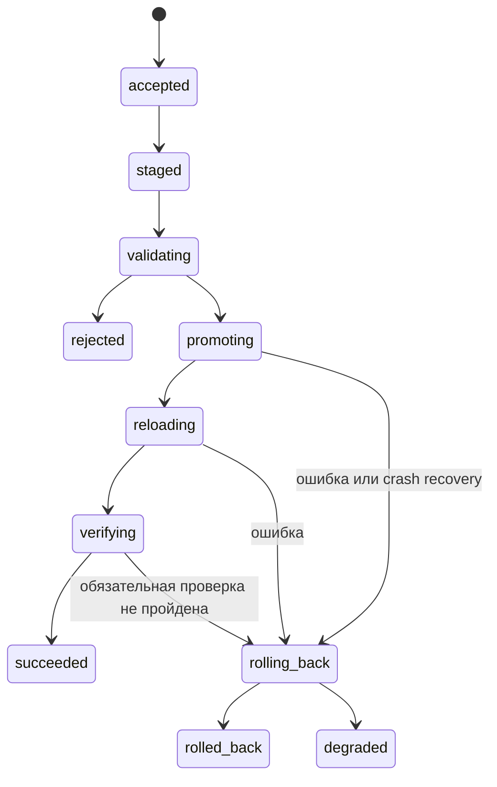

# Жизненный цикл конфигурации

Цель: сохранить рабочий доступ при ошибках панели, генератора, reload и reboot.
Это проект протокола, а не утверждение о транзакционности самого Squid.
SQLite, filesystem и процесс Squid не участвуют в общей ACID-транзакции.

## Три состояния

- **Desired** — сохранённый черновик настроек в web DB.
- **Applied** — ревизия, для которой runtime module завершил применение и проверки.
- **Observed** — реально наблюдаемые process health, checksum, probes и время замера.

Они показываются раздельно. Факт сохранения формы не означает apply;
exit code reload не доказывает готовность Squid и правильность ACL.

## Предпросмотр и пользовательские изменения

`GET /configuration/preview` читает сохранённый draft, возвращает полный итоговый
конфиг и diff без записи новой revision. `summary` содержит только пользовательские
изменения; при их отсутствии это пустой массив. Сравнение разворачивает defaults,
считает пустые списки и omitted значения эквивалентными, нормализует IP/CIDR и
порядок set-like ACL. Порядок DNS servers и экспертный текст остаются значимыми.
Криптографические policy hashes сохранённых ревизий этим сравнением не меняются.

`user_changes` и status `has_unapplied_changes` показывают изменение пользовательской
конфигурации. `runtime_changes` и status `runtime_update_available` отдельно
показывают необходимость перерендерить действующий snapshot текущим compiler и
параметрами установки. Поэтому служебное обновление не изображается как замена
пользовательской настройки самой на себя и не скрывается под «нет изменений».
Diff использует построчное LCS-сравнение с unified hunks и тремя строками
контекста. Только generated revision fingerprint нормализуется; compiler и
остальные directives сохраняются. Матрица ограничена 4 млн ячеек (8 MB), вывод —
400 строк; превышение явно обозначается вместо ложной замены всего блока.
Полный generated_config возвращается без изменений. Parse/apply по-прежнему
требуют immutable revision и явного действия. Expert template без клиентов
возвращает рабочий fail-closed `http_access deny all`, не пустое поле.

HTTP/TLS listener ports принадлежат установке. Draft PUT и validate/apply/rollback
ревизии с другими listener ports возвращают `422 installation_setting`. Это не
затрагивает safe destination ports и CONNECT ports. Ранее установленные другие
listeners не заменяются defaults; история не предлагает такой откат как допустимый.
Штатный Compose публикует 3128/3129; произвольное изменение упаковки из web отсутствует.

## Ревизия

Immutable bundle содержит canonical policy JSON, compiler version, schema version,
image digest, capabilities profile, rendered config, content hashes и ссылки на
версии секретов без самих ключей. Время и actor хранятся в metadata, не делают
детерминированный config случайно отличающимся при каждом рендере.
Preview и apply используют один чистый compiler внутри Go-приложения.

TLS-key rotation — отдельная revisioned операция с собственными prerequisites.
Rollback политики не должен ссылаться на уже удалённый сертификат/CA.

## Конкурентность и приём команды

Draft использует optimistic lock `version`. Preview и validation привязаны к
точным hash policy, compiler и image. При изменении чего-либо validation устаревает.
Apply передаёт immutable snapshot, expected applied revision и idempotency key.

Runtime module держит один межпроцессный file lock для validate/promote/reload/rollback и certificate rotation.
Новый apply при занятом lock получает busy; скрытой очереди нет.
Одинаковый idempotency key с тем же payload возвращает прежний operation ID;
с другим payload — conflict. Повтор после timeout не запускает второе применение.

Приложение создаёт durable operation intent и audit event в одной DB-транзакции.
Внутренний worker сохраняет journal/snapshot перед promotion; операции не зависят
от request context браузера. После disconnect клиент запрашивает прежний ID/key.
После restart reconciliation связывает operation intent с journal `runtime.journal`
той же БД до новых mutations. При недоступной DB новая mutation не начинается. Публичный 202 означает
сохранённый intent, а не завершённое применение или принятие удалённым сервисом.

## Алгоритм apply

1. Проверить schema, source ranges, домены, TLS-профиль, capability profile,
   expected revision, свободное место и наличие всех secret references.
2. Скомпилировать immutable policy во внутреннем модуле. Сверить hash с preview.
3. Сохранить candidate bundle в служебном staging с ограниченными правами на том же filesystem,
   `fsync` файлов и каталога. Journal: `staged` с указанием предыдущей LKG.
4. Parse **весь bundle** локальным бинарником Squid из того же итогового image,
   в этом же контейнере. Фиксированные argv/paths, без shell и Docker API.
   Candidate использует изолированные writable paths; проверить, что parse не
   меняет live PID/cache/log. Подмена host Squid не допускается.
5. Semantic validation: неизменность защитных правил, неизвестная VM deny,
   отсутствие пустого allow-all, соответствие политики и ACL. Parse недостаточно.
6. Зафиксировать journal `promoting` до замены. Атомарно заменить активный config
   `squid.conf` в tmpfs `/dev/shm/kraken` через rename в том же каталоге.
   Journal и LKG хранятся в управляющей БД (ключи `runtime.journal`,
   `runtime.last_good`), применения сериализует flock `apply.lock` в tmpfs.
   Конфигурация — один файл: каждое применение переписывает её целиком.
7. Journal `reloading`. Выполнить проверенный для image control command Squid
   без shell и без сигнала PID 1 наугад. Timeout ограничен; stdout/stderr обрезаны.
8. Journal `verifying`. Проверить process health, наблюдаемые ошибки reload,
   соответствие активного bundle и поведенческие allow/deny probes.
9. После успешных probes записать LKG manifest в БД, затем durable
   terminal journal `succeeded` с hash/результатами и запись applied/audit в DB.
   Это не общая транзакция: crash между шагами разбирается recovery, при
   неопределённости сохраняется консервативный откат к recorded previous LKG.
10. При ошибке после promotion: journal `rolling_back`, вернуть предыдущий bundle,
    повторно parse/reload/verify; закончить `rolled_back` или `degraded`.

Бюджеты по умолчанию: parse 15 s, reload acknowledgement 10 s, verify 30 s
(соответствует `VerifyBudget` в `manager.go`), rollback до 45 s. Значения
конфигурируемы через env `KRAKEN_PARSE_TIMEOUT` / `KRAKEN_RELOAD_TIMEOUT` /
`KRAKEN_VERIFY_BUDGET` (Go duration syntax, диапазон (0, 5 m]); это не обещание SLA. Нельзя убивать безопасное восстановление только потому, что
браузер закрылся.

Recover после рестарта читает journal. Незавершённый apply восстанавливает
recorded previous manifest. На первом запуске durable first_run marker пишется
до squid.conf. Если LKG ещё нет, инициализация повторяется; если LKG уже есть,
проверяется совпадение candidate/LKG и squid.conf, затем сохраняется initialised.
При каждом старте `serve` пишет `squid.conf` в tmpfs из точного текста LKG (без
повторного рендера) и экспорт логинов прокси из БД; только после этого
`squid-start` запускает Squid. Ошибка чтения journal или LKG из БД — ошибка
recovery, а не «первый запуск».
Offline recovery перед стартом Squid восстанавливает файлы, сохраняя pending
journal. Online recovery закрывает journal как rolled_back только после успешных
reload и fingerprint probe. Ошибка, включая ещё не запущенный Squid, сохраняет
pending journal и возвращается вызывающему коду; serve завершается, Pebble
повторяет его запуск. Это не заменяется проверкой совпадения файлов на диске.
Решение: [ADR 0010](../adr/0010-session-and-recovery-safety.md).

## Что означает verify

Локальный probe не доказывает все пользовательские ACL. Нужны два уровня:
фиксированные runtime probes плюс integration suite с отдельными source IP.
Внутренний модуль никогда не выбирает destination URL из произвольной строки UI.
Он использует оператором настроенные фиксированные endpoints и test fixtures.

Чтобы новая разрешающая ревизия не была ошибочно проверена по старым ACL,
verification должен наблюдать её fingerprint доступным проверенным механизмом
— loopback canary с fingerprint ревизии ([image compatibility](../research/image-compatibility.md)).
Если поддерживаемого доказательства нет, UI показывает `unverified`, а applied/LKG
не объявляется подтверждённой только по `squid -k reconfigure` exit code.

Потеря внешнего тестового origin не должна бесконечно откатывать корректные правила.
Разделять отрицательный policy probe, локальную runtime-проверку и внешний
availability probe. Обязательные проверки для успеха фиксируются manifest;
внешняя недоступность диагностируется отдельно. При отсутствии достаточных
доказательств применённости — conservative rollback или degraded по этапу операции.

## Состояния операции

Implementation stages in the durable journal: `first_run`, `promoting`,
`reloading`, `rolling_back`, `terminal` (+ outcome `initialised`/`succeeded`/
`rolled_back`). The OpenAPI `Operation.status` enum exposes only the
public-facing subset (`pending`, `validating`, `validated`, `reloading`,
`succeeded`, `rejected`, `rolled_back`, `degraded`); internal stages like
`staged`/`promoting`/`verifying`/`accepted` from the diagram above are not
emitted by the current worker (the worker transitions straight from `pending`
to `validating` or `reloading` without separate acknowledgement markers).
Either alignment is a future slice: code could emit `staged` between `pending`
and `validating`, or the spec could be trimmed to the emitted statuses only.

`rejected`: активная конфигурация не менялась.
`rolled_back`: предыдущая конфигурация восстановлена и проверена.
`degraded`: итоговое состояние не доказано; новые изменения блокируются до recovery.
Отдельная операция validate завершается `validated` или `rejected`, без promotion.
`draft` (не на диаграмме) используется listRevisions COALESCE для ревизий без
операций; это не operation status, а summary visibility.

## Восстановление после сбоя

| Момент сбоя | Поведение recovery после запуска |
| --- | --- |
| До durable journal | SQLite intent может существовать, runtime не менялся; reconcile по тому же ID/key |
| Candidate записан, активный не менялся | Удалить/сохранить staging для диагностики; active не трогать |
| Journal promoting/reloading/verifying | При неопределённости вернуть recorded LKG и проверить |
| LKG записан, web DB не обновилась | Согласовать terminal journal с DB до новых mutations |
| Во время rollback | Повторить rollback идемпотентно; при невозможности degraded |
| Нет рабочей ревизии | Старт deny-all, не allow-all |
| Секрет ревизии отсутствует | Не пытаться insecure fallback, показать missing prerequisite |

Recovery gate выполняет reconciliation filesystem/journal **перед каждым** запуском
Squid: первоначальный старт, restart контейнера/VM и отдельный restart Squid
через Pebble. Gate — `kraken squid-start` того же бинарника. Он и web worker используют один lock, чтобы Squid не
стартовал на pending candidate. Web readiness не требуется для старта из LKG.
При restart только панели работающий Squid не останавливают; прежде новых
mutations worker завершает reconciliation, при необходимости rollback/reload.
Проверяется и недоступная DB: gate использует persistent LKG metadata, не создавая
разрешающий default. Неподтверждённое recovery блокирует небезопасный запуск.

Drift от ручного изменения конфигурации обнаруживается по hash. Модуль не
перезаписывает неожиданный файл молча: read-only режим панели и явный recovery.
Ручной rollback также создаёт новую операцию, ссылающуюся на старый bundle.

## Расширение настроек и expert mode

Snapshot включает settings, configuration_mode и expert_config. Редактор допускает
пользовательскую секцию, guard проверяет lifecycle/command границы, полный файл
генерируется общим compiler. Визуальные правила не смешиваются с expert ACL.
Смена режима также проходит revision/diff/parse/apply/verify.
Rollback имеет собственный ограниченный context (45 s), независимый от отменённого
forward operation. Ошибка сохранения terminal outcome в DB блокирует новые apply
в этом процессе до restart/reconciliation. Manifest фиксирует фактический compiler. Rollback допускает только совместимые
compiler/image ревизии; старые исторические ревизии остаются доступными для чтения.

Compiler 6 добавляет read-only management listener для live metrics. Старый
active config сохраняет прежние ACL до отдельного служебного применения applied
snapshot; GET metrics возвращает configuration_update_required. Просмотр не
применяет пользовательский draft. [ADR 0013](../adr/0013-read-only-squid-metrics.md).

Локальный `kraken service-update` создаёт immutable revision из текущего
LKG snapshot и operation/audit (`local-cli`, `service_update`). Команда не читает
и не меняет draft, использует обычный Runtime.Apply с expected revision, file lock,
parse, durable journal, verify и rollback. Ошибка busy/recovery/conflict видна CLI;
повторное применение уже актуального service config отклоняется как no-op.
