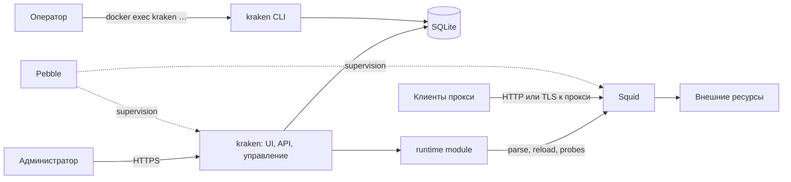

# Архитектура

Один контейнер: Pebble, процесс Squid и Go-бинарник `kraken` со встроенным React UI
([ADR 0006](../adr/0006-single-container.md)). Проверенная среда — Linux/arm64;
остальные платформы не объявляются проверенными. Измерения базового образа —
[image compatibility](../research/image-compatibility.md).

## Процессы

Образ строится на зафиксированном Alpine; Squid собирается из upstream-релиза
([ADR 0019](../adr/0019-alpine-upstream-squid.md)). Фронт собирается в статические
файлы и встраивается в бинарник через `go:embed`; Node нужен только при сборке.
Pebble — PID 1 и supervisor двух сервисов: `kraken serve` и `kraken squid-start`.



Запросы клиентов не проходят через панель. Падение `kraken` Pebble перезапускает
отдельно, Squid продолжает работать с последними правилами. Пересоздание контейнера
прерывает оба процесса и открытые соединения.

## Компоненты и полномочия

| Компонент | Ответственность | Доступ |
| --- | --- | --- |
| `kraken serve` | HTTPS, вход, UI/API, черновик, применение, аудит, сбор событий | Ключ панели, SQLite, runtime state, access log |
| `kraken` CLI | Обслуживание оператором внутри контейнера | То же, всегда от UID `kraken` |
| `internal/runtime` | Рендер, parse, reload, verify, откат, recovery | Фиксированные пути и argv Squid, lock, journal |
| Squid | Forward proxy, ACL, CONNECT, TLS к прокси | Конфигурация на чтение, логи, ключ TLS прокси |
| Pebble | Запуск и независимый перезапуск процессов | Только локальные сервисы |

Runtime module — часть Go-процесса, а не отдельный демон или граница изоляции.
Docker socket, privileged mode и host namespaces отсутствуют. Компрометация панели
позволяет изменить правила прокси; снижение риска — минимальные права и строгая
типизированная политика.

## Порты и данные

```text
container
  Pebble
    kraken  HTTPS 8443 (публикуется на management-интерфейс хоста)
    squid   HTTP 3128, TLS 3129 (порты задаются установкой)
            127.0.0.1:3130 — probe, 127.0.0.1:3131 — manager, без публикации
  volume /var/lib/kraken
    data/      control.sqlite3 (в т.ч. журнал применения и LKG), telemetry/   kraken 0700
    certs/     сертификаты панели и прокси        kraken:proxy 2750
    log/       access.log и ротации, cache.log    proxy
  tmpfs /dev/shm/kraken                           kraken:proxy 2750, Squid только читает
    squid.conf, proxy-accounts.json, manager-auth.conf, apply.lock
  tmpfs /dev/shm/kraken-squid                     proxy 0700: PID Squid
```

Go работает как `kraken` (10013, доп. группа `proxy`), Squid — как `proxy` (13).
Squid читает файлы `/dev/shm/kraken` и сертификат прокси через группу, но не может
их создавать, заменять или удалять; SQLite и ключ панели ему недоступны ([ADR 0015](../adr/0015-separate-squid-uid.md),
[deployment](../operations/deployment.md#файлы-и-права)).

## Локальное управление

Squid запускается только с фиксированными argv: `-N -f /dev/shm/kraken/squid.conf` и `-k parse`.
Reload и rotate — `GET /squid-internal-mgr/<action>` с Basic-паролем менеджера на loopback 3131
([ADR 0013](../adr/0013-read-only-squid-metrics.md)); shell и произвольные пути из UI
не используются, соседние контейнеры и Docker API не трогаются.

## Запуск и восстановление

Перед каждым запуском Squid, включая перезапуск Pebble, `squid-start` ждёт, пока
`serve` согласует journal и LKG и подготовит рабочую конфигурацию или deny-all,
удаляет устаревший pid-файл после принудительной остановки и делает exec Squid.
При перезапуске панели reconcile выполняется до приёма изменений; работающий Squid
не останавливается без необходимости. Повреждённый journal или отсутствие секретов
ведут к fail closed, а не к запуску неизвестной конфигурации.
Один контейнер не даёт HA; обновление образа требует окна прерывания трафика.

## Код

```text
src/
  cmd/control/        бинарник kraken: serve, squid-start, CLI оператора
  internal/policy/    типизированная модель, валидация, рендер squid.conf
  internal/httpapi/   HTTPS handlers, сессии, CSRF, область менеджера, операции
  internal/store/     SQLite панели
  internal/runtime/   адаптер Squid, journal, lock, recovery
  internal/events/    чтение access.log
  internal/help/      встроенные статьи справки
  migrations/         встроенные SQL-миграции
  web/                React UI
  tests/integration/  проверки на реальном образе
  tools/              инструменты разработки
deploy/               Dockerfile, Compose, Pebble
```

`internal/policy` не импортирует HTTP, SQLite и runtime. Контракт runtime-модуля —
[runtime contract](../../api/runtime-contract.md). Устройство UI —
[interface](../product/interface.md).
