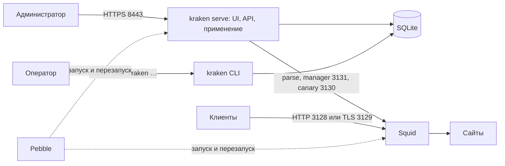

# Архитектура

Один контейнер: Pebble, процесс Squid и Go-бинарник `kraken` со встроенным React UI
([ADR 0001](../adr/0001-single-container.md)). Образ собирается для amd64 и arm64.

## Процессы



- PID 1 — `kraken entrypoint` от root: готовит том и делает `exec` Pebble
  ([ADR 0013](../adr/0013-install-and-certificates.md)).
- Pebble запускает два сервиса: `squid` (`kraken squid-start` под `proxy`) и
  `control` (`kraken serve` под `kraken`). Pebble при `user:` сбрасывает
  дополнительные группы, поэтому `control` понижает права через
  `setpriv --init-groups` и сохраняет группу `proxy`.
- Запросы клиентов не проходят через панель. Падение `serve` Pebble перезапускает
  отдельно, Squid продолжает работать по последним правилам. Перезапуск контейнера
  останавливает оба процесса и рвёт открытые туннели.

## Компоненты и полномочия

| Компонент | Отвечает за | Доступ |
| --- | --- | --- |
| `kraken serve` | HTTPS, вход, UI и API, черновик, применение, аудит, сбор событий | Управляющая БД, телеметрия, ключ панели, tmpfs, access log через группу |
| `kraken` CLI | Обслуживание оператором | То же, всегда от UID `kraken` |
| `internal/runtime` | Рендер в файл, parse, reload, проверка, откат, восстановление | Фиксированные пути и argv Squid, `flock` |
| Squid | Прокси, ACL, CONNECT, TLS к прокси | Конфиг и экспорт логинов на чтение, ключ прокси, свои логи |
| `kraken proxy-auth` | Helper Squid для логинов прокси | Только экспорт верификаторов в tmpfs |
| Pebble | Запуск и независимый перезапуск сервисов | Локальные сервисы |

Модуль применения — часть процесса панели, а не отдельный демон и не граница
изоляции. Docker socket, privileged mode и host namespaces не используются.

## Порты

| Порт | Слушает | Публикуется | Назначение |
| --- | --- | --- | --- |
| 8443 | панель | да, `KRAKEN_MANAGEMENT_BIND` | HTTPS панели |
| 3128 | Squid | да, `KRAKEN_PROXY_BIND` | HTTP-прокси |
| 3129 | Squid | да, `KRAKEN_PROXY_BIND` | TLS к прокси, логины прокси |
| 127.0.0.1:3130 | Squid | нет | Canary: проверка отпечатка ревизии |
| 127.0.0.1:3131 | Squid | нет | Manager: отчёты, reload, rotate ([ADR 0010](../adr/0010-squid-manager.md)) |

Порты 3128 и 3129 принадлежат установке: черновик и старая ревизия их не меняют.

## Файлы

```text
/var/lib/kraken                       том, kraken:proxy 0750
  data/       control.sqlite3, telemetry/      kraken 0700
  certs/      ca.*, panel.*, proxy.*           kraken:proxy 2750
  log/        access.log и ротации, cache.log  proxy 2750
  backups/    архивы kraken backup             kraken 0700 (создаётся командой)
/dev/shm/kraken                       tmpfs, kraken:proxy 2750, Squid только читает
  squid.conf, proxy-accounts.json, manager-auth.conf, apply.lock
/dev/shm/kraken-squid                 tmpfs, proxy 0700: PID Squid
```

Производные файлы в tmpfs `serve` пересоздаёт из управляющей БД при старте и при
каждом применении; на томе их нет. Права и обоснование —
[ADR 0009](../adr/0009-separate-squid-uid.md) и
[deployment](../operations/deployment.md#файлы-и-права).

## Управление Squid

- Запуск — только `squid -N -f /dev/shm/kraken/squid.conf`, проверка — `squid -k parse`
  с фиксированными путями, без shell.
- Reload и rotate — `GET /squid-internal-mgr/<action>` с паролем менеджера на
  loopback 3131. Пароль новый на каждый старт контейнера и живёт только в tmpfs.
- Проверка применения — запрос на loopback canary 3130: ответ защитного запрета несёт
  отпечаток компилятора, снимка и параметров установки. Это доказывает, что Squid
  перечитал именно эту ревизию; поведение клиентских правил проверяют
  integration-тесты.
- Перед каждым запуском Squid `squid-start` ждёт, пока `serve` восстановит журнал
  применения и запишет конфиг из LKG, удаляет устаревший PID-файл после
  принудительной остановки и делает `exec` Squid.

Подробно — [configuration-lifecycle](configuration-lifecycle.md).

## Идентичность образа

Ссылки Alpine и Squid из `deploy/Dockerfile` (с digest) и версия Kraken вшиваются в
бинарник при сборке и видны в `kraken version` и `kraken status`. Ревизия
откатывается только на том образе, где применялась. Сборка вне Dockerfile
называется `dev`.

## Код

```text
src/
  cmd/control/        бинарник kraken: entrypoint, serve, squid-start, proxy-auth, CLI
  internal/policy/    модель, валидация, рендер squid.conf (без HTTP, SQLite и runtime)
  internal/httpapi/   HTTPS-обработчики, сессии, CSRF, область менеджера, операции
  internal/store/     управляющая SQLite
  internal/telemetry/ события и агрегаты
  internal/events/    чтение access.log
  internal/runtime/   адаптер Squid, журнал применения, восстановление
  internal/admin/     операции CLI: пользователи, сессии, копия
  internal/credentials/ Argon2id PHC
  internal/proxyauth/ helper логинов прокси
  internal/tlscert/   CA установки и серверные сертификаты
  internal/csp/       Content-Security-Policy панели
  internal/help/      встроенные статьи справки
  migrations/         SQL-миграции
  web/                React UI, встраивается в бинарник
  tests/integration/  тесты на реальном образе
  tools/              docs-check, слияние SBOM
deploy/               Dockerfile панели, squid/ (образ Squid), Compose, слой Pebble
```

Устройство UI — [interface](../product/interface.md).
