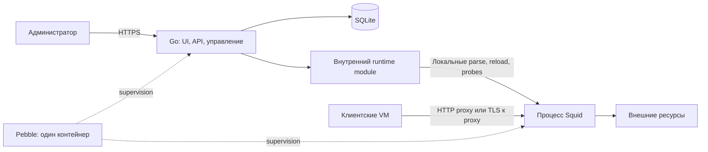

# Архитектура

Статус: упаковка в один контейнер согласована владельцем 27.10.2026;
детали реализации и совместимость образа ещё проверяются.
Решение: [ADR 0006](../adr/0006-single-container.md).
Первый срез реализован; измерения: [capability report](../research/image-compatibility.md).

## Контекст и процессы

Один собственный OCI image строится на pinned `ubuntu/squid`.
Фронт собирается в статические файлы и встраивается в один Go-бинарник
`squid-control`. Бинарник обслуживает HTTPS-панель, API, SQLite и управление Squid.
Squid остаётся отдельным процессом. Pebble добавляется нашим Dockerfile, является PID 1 и supervisor обоих сервисов.
Node нужен только на стадии сборки; отдельного frontend server в runtime нет.



Запросы VM не проходят через web-приложение. При падении процесса панели Pebble
перезапускает только его, Squid продолжает работу с последними правилами.
Остановка/пересоздание всего контейнера прерывает оба сервиса и активные соединения.

## Компоненты и полномочия

| Компонент | Ответственность | Доступ |
| --- | --- | --- |
| squid-control | HTTPS, auth, UI/API, drafts, operations, audit | Panel TLS key, SQLite, state/config/logs по необходимости |
| internal/runtime | Типизированный compiler, parse, reload, verify, rollback | Фиксированные Squid paths/argv, lock и filesystem journal |
| Squid/helper | Forward proxy, ACL, TLS и SSL Bump | Config read, logs/cache/cert DB write, нужные proxy/CA keys |
| Pebble | Запуск и независимый restart процессов | Только необходимое управление локальными сервисами |

Runtime module — часть Go-приложения, не отдельный демон, не IPC API и не граница
изоляции от web-кода. Docker socket, privileged mode и host namespaces отсутствуют.
Компрометация панели потенциально позволяет изменить proxy config и доступ VM;
общий контейнер увеличивает общую зону поражения. Снижение риска — минимальные
права и строгая модель политики, а не обещание изоляции внутри одного процесса.

## Стек

Go с `net/http` для API/HTTPS; React + TypeScript + Vite для интерфейса;
статический build встроен через `go:embed`. SSR/SEO закрытой панели не нужны.
SQLite — local disk, WAL и согласованный backup. Конкретные toolchain, dependencies
и lockfiles фиксируются с первым кодовым срезом.

Compose описывает **один сервис** с одним image и volumes. Host runner, отдельный
web/edge container, systemd unit приложения и Docker Engine API клиент не нужны.
Go сам завершает TLS панели. Перед ним можно поставить существующий ingress,
если он уже есть в инфраструктуре; это не обязательный компонент установки.

## Порты и постоянные данные

```text
proxy VM: Docker Engine / Compose
  container
    Pebble
      squid-control: HTTPS UI/API, например 8443 -> host management IP:443
      squid: 3128 (HTTP, если включён), 3129 (TLS, после capability check)
  volumes / read-only secret mounts
    /var/lib/squid-control/app/       SQLite
    /var/lib/squid-control/runtime/   journal, revisions, LKG, межпроцессный lock
    /etc/squid/managed/               активный versioned config directory
    /var/log/squid/                   ограниченные logs
    /var/spool/squid/                 необязательный disposable cache
    /run/secrets/...                  panel/proxy TLS keys и inspection issuer
```

Пути и порты целевые и проверяются image spike. Внешняя привязка панели только к
management interface, listeners proxy — к клиентскому interface. Внутренний 8443
позволяет Go-процессу не требовать привилегированного порта.
Config каталог RW для управляющего процесса и read-only по Unix permissions
для Squid, где это позволяет выбранная схема UID/GID. Один mount сам по себе
не создаёт per-process RO: права и ownership проверяются отдельно.

## Локальное управление

Приложение запускает установленный в этом же image Squid с фиксированными argv
для parse/reconfigure. Shell и произвольный command/path из UI не используются.
Проверки не создают соседние контейнеры и не обращаются к Docker API.

UID/GID, права на PID/control path и возможность reload проверяются до реализации.
Не запускать весь web root ради сигнала. Если нужны разные UID, выбрать проверенный
узкий механизм локального control доступа; при невозможности — пересмотреть
capability profile, а не добавлять universal exec или Docker socket.

## Запуск и восстановление

При первом старте и перед **каждым** запуском Squid, включая restart Pebble,
обязателен recovery gate: согласовать journal/LKG, установить рабочий bundle или
bootstrap deny-all, затем разрешить старт Squid. Это не зависимость от HTTP
readiness панели и не одноразовый hook только на старте контейнера.

Gate реализуется локальным подрежимом того же Go-бинарника в проверенном startup
path Pebble. Он и фоновый worker используют один filesystem lock. При restart
панели reconcile выполняется до приёма новых mutations; работающий Squid не
останавливается без необходимости recovery. Поведение при повреждении journal
и отсутствии секретов: fail closed/degraded, не запуск неизвестного candidate.

Независимые restart policies и permissions — обязательный результат image spike.
Обычный aggregate unhealthy сам по себе не должен приводить внешним watchdog
к restart всего контейнера при падении только панели.

Один контейнер/VM не обеспечивает HA. Обновление Go или Squid выпускает новый
совместно протестированный image и требует окна возможного прерывания трафика.
Disk cache на старте можно оставить выключенным.

## Структура кода в src/

```text
src/
  cmd/control/              executable: serve, bootstrap, dev-cert, squid-start, check
  internal/policy/          typed model, validators и compiler
  internal/httpapi/         HTTPS handlers, sessions/CSRF и операции
  internal/store/           SQLite
  internal/runtime/         local Squid adapter, journal, locks и recovery
  migrations/               embedded initial SQL
  web/                      React/TS, static build, browser tests
  tests/integration/        реальные сетевые fixtures
  tools/                    безопасный host helper bootstrap
deploy/                     Dockerfile, Compose и Pebble plan
scripts/                    проверка документации
```

Все application directories схемы находятся под `src/`; `deploy/` остаётся в корне.
`src/internal/runtime` сейчас содержит локальный adapter и manager без подпакетов.
Go и Squid в первом срезе используют общий UID 13; это разрешает reload,
но не изолирует config/secret permissions между процессами. Контракт внутреннего модуля:
[runtime contract](../../api/runtime-contract.md). `internal/policy` не импортирует
HTTP, SQLite или runtime/process APIs.
